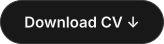
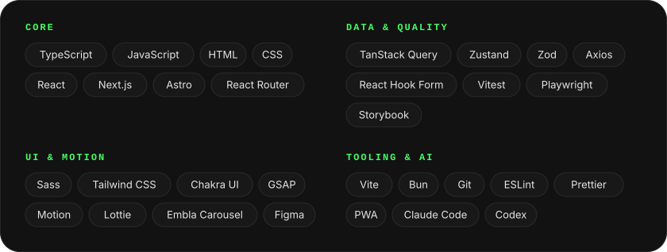
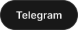
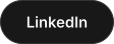

&nbsp;
&nbsp;

I’m a Frontend Engineer with **8+ years** of experience building fast, accessible websites and web applications in **React, Next.js and TypeScript**. I focus on clear interfaces, reliable implementation, and a flexible approach to every product and client. I pick the solution for the task, not the task for the solution.

### Currently in development

### Career

### Skills, tools and technologies

### Reviews

 

&nbsp;
&nbsp;
&nbsp;

