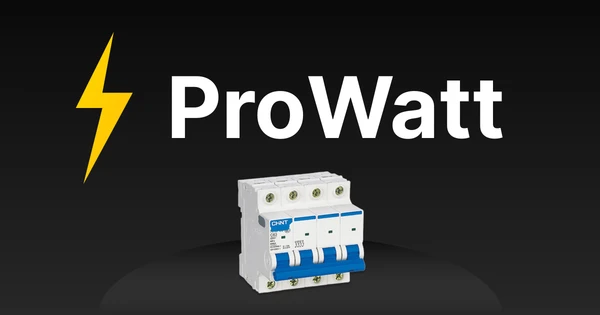
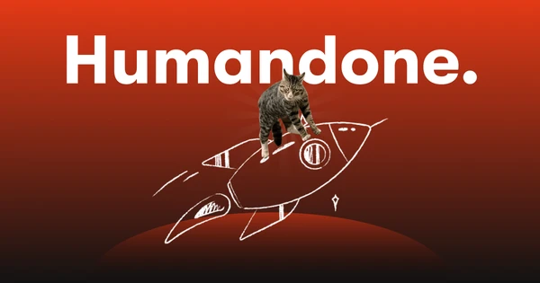

&nbsp;
&nbsp;

I’m a Frontend Engineer with **8+ years** of experience building fast, accessible websites and web applications in **React, Next.js and TypeScript**. I focus on clear interfaces, reliable implementation, and a flexible approach to every product and client. I pick the solution for the task, not the task for the solution.

### Currently in development

### Career

### Recent projects

<table>
  <tr>
    <td width="50%" valign="top">
      
      <h4><a href="https://dafna.uz/">Dafna</a></h4>
      Online store for one of Uzbekistan’s leading furniture brands.  
      <code>React</code> <code>Next.js</code> <code>Redux</code> <code>CSS Modules</code>
    </td>
    <td width="50%" valign="top">
      
      <h4><a href="https://prowatt.uz/">Prowatt</a></h4>
      Website offering electrical installation services across Tashkent.  
      <code>Astro</code> <code>Nanostores</code> <code>Lucide</code> <code>CSS Modules</code>
    </td>
  </tr>
  <tr>
    <td width="50%" valign="top">
      
      <h4><a href="https://mirislamus.github.io/pomodoro">Pomotomo Focus Timer</a></h4>
      Personal Pomodoro focus timer designed to support concentration and task completion.  
      <code>React</code> <code>Vite</code> <code>Chakra UI</code> <code>Zustand</code>
    </td>
    <td width="50%" valign="top">
      
      <h4><a href="https://humandone.com/">Humandone</a></h4>
      Corporate website for a studio building websites, web applications, and Web3 products.  
      <code>React</code> <code>Gatsby</code> <code>Chakra UI</code> <code>GSAP</code>
    </td>
  </tr>
</table>

<a href="https://mirislamus.github.io/#projects">More projects →</a>

### Skills, tools and technologies

### Reviews

 

&nbsp;
&nbsp;
&nbsp;

